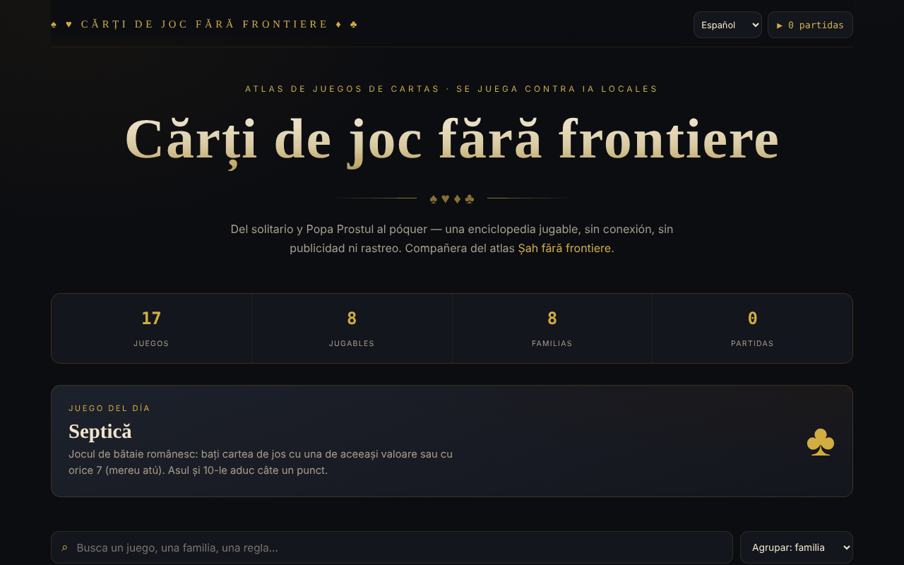

# Cărți de joc fără frontiere

[English](README.md) · [Română](README.ro.md) · [Français](README.fr.md) · [Italiano](README.it.md) · **Español** · [Português](README.pt.md) · [Deutsch](README.de.md) · [Magyar](README.hu.md)

**Versión:** 1.2.9 · **Última actualización:** 2026-10-23

Idiomas de la interfaz: **Română, English, Français, Italiano, Español, Português (PT), Deutsch, Magyar**

Atlas de juegos de cartas con ocho juegos jugables, en un único archivo HTML.

**Aplicación en línea:** https://chiuta.github.io/Carti-de-joc-fara-frontiere/

## Qué es

Un atlas interactivo de juegos de cartas, desde el Solitario y el Popa Prostul (el Mus de la Dama, o «Old Maid») hasta el póker, descrito en la aplicación como «enciclopedia jugable, sin conexión, sin publicidad y sin rastreo». El catálogo agrupa los juegos por familias; para cada juego hay una ficha con información y reglas, y algunos pueden jugarse directamente en la página. Es el complemento del atlas «Șah fără frontiere» (Ajedrez sin fronteras).

## Funciones

- Catálogo de 17 juegos, agrupados en familias: Para niños y rápidos, Juegos rumanos, De descarte, De bazas, Combinaciones y rummy, Familia del póker, Casino y apuestas, Solitario (paciencia).
- Ocho juegos jugables (según la nota del pie de página): Solitario (Klondike), Guerra, Popa Prostul, Macao, Crazy Eights (Opt nebun, 1 contra 1 con el ordenador), Septică, Blackjack y Texas Hold'em. El resto están documentados.
- Búsqueda en títulos, descripciones, etiquetas y reglas («Busca un juego, una familia, una regla…»).
- Orden: agrupación por familias, alfabético A→Z, dificultad creciente, jugables primero.
- Filtros por familias, más el filtro «★ Solo jugables».
- Ficha de juego con número de jugadores, época, dificultad; marcado como favorito (★).
- Juego del día y contador de estadísticas (juegos, jugables, familias, partidas jugadas).
- Accesibilidad en la mesa: nombres de las cartas en rumano y anuncio de los mensajes del juego para lectores de pantalla.
- Botón **▶ Jugar** en la ficha de cada juego jugable; **Cerrar** / ✕ / **Esc** para salir.

## Manual de uso

1. Abre la página; arriba ves las estadísticas y el juego del día.
2. Busca en el campo de búsqueda o elige una familia entre los chips; cambia el orden en la lista de ordenación.
3. Pulsa un juego para abrir su ficha con las reglas. Pulsa ★ en la ficha para marcarlo como favorito.
4. Si el juego está marcado como «Jugable», pulsa **▶ Jugar** y sigue las indicaciones de la mesa.
5. Cierra la ficha o la mesa de juego con **Cerrar**, ✕ o **Esc**.
6. El contador «▶ N partidas» de la esquina superior muestra cuántas partidas has empezado.

## Advertencia

Los juegos (incluidos Blackjack y Texas Hold'em, de la familia «Casino y apuestas») son simulaciones educativas con fichas virtuales; no se apuesta dinero real. Los juegos de azar con dinero pueden crear adicción y están destinados a adultos. Los adversarios de los juegos jugables son programas locales (la aplicación los llama «IA locales»); la aplicación muestra una nota en el pie de página.

## Privacidad y red

- **Almacenamiento local (localStorage):** dos claves con prefijo `carti-de-joc.`, `carti-de-joc.fav` (los juegos favoritos) y `carti-de-joc.played` (el número de partidas). No se envían a ninguna parte.
- **Red:** no hay solicitudes `fetch`, scripts, fuentes ni imágenes externos. La página solo incluye enlaces que se abren al hacer clic: Șah fără frontiere (alexio.tf), Buy Me a Coffee. La página tiene una política CSP restrictiva (`default-src 'self'`). No hay telemetría.

## Ejecución local / sin conexión

Descarga `index.html` y ábrelo en el navegador; no necesita internet (los enlaces externos sí).

## Licencia

Licencia MIT — consulta el archivo `LICENSE`. El encabezado de `index.html` y el texto de la interfaz indican la misma licencia (una mención anterior de «CC-BY-SA 4.0» en la interfaz se eliminó en la auditoría, 2026-10-11, para eliminar la contradicción).

## Marcas

Los nombres de juegos son denominaciones comerciales de sus titulares, usadas de forma descriptiva; el proyecto no está afiliado a ellos.

## Auditoría

Auditoría: 2026-10-10 — verificado con Playwright y axe-core (catálogo, fichas y mesas de los siete juegos de entonces); verificado en el código: sin `fetch`, CSP `default-src 'self'`. Corregido: una casilla decorativa enfocable (axe serious); añadida una advertencia sobre los juegos de azar.

## Autor

Alexio — Alexandru-Ionuț Chiuță, Centrul StrING (según se menciona en la aplicación). Contacto: alexio@trom.tf

## Resumen

Cărți de joc fără frontiere es un atlas de un solo archivo con 17 juegos de cartas agrupados por familias, con búsqueda, ordenación, favoritos y ocho juegos jugables (Solitario Klondike, Guerra, Popa Prostul, Macao, Crazy Eights, Septică, Blackjack, Texas Hold'em). Solo guarda en localStorage los favoritos y un contador de partidas jugadas, y no carga recursos externos. La interfaz está en rumano. Licencia MIT (consulta LICENSE).

## Novedades (v1.1.0)

- **Juego de dos en red** (botón «Jugar de dos, en red» en la ficha de Crazy Eights): partida entre dos personas, el mismo reparto para ambos (semilla común), la mano del adversario permanece oculta, las jugadas fuera de turno se rechazan. La conexión se establece directamente entre los dos navegadores (WebRTC), sin servidor nuestro: se intercambian dos textos (oferta/respuesta), como texto o código QR, por cualquier canal que elijas. Por defecto no se contacta ningún servidor STUN; se puede introducir uno manualmente en la ventana de conexión, solo si lo deseas. Si el enlace se interrumpe, la aplicación lo muestra y puede reanudar la partida desde el registro de jugadas.
- **Búsqueda local** en el catálogo de juegos (FFF.search): encuentra también sin signos diacríticos o con pequeños errores, en el texto de las reglas y de las descripciones; sin red.
- **Lectura en voz alta** de las reglas (botón «Escuchar», FFF.tts), con elección de la voz.
- Kit común (core, label, bundle, qr, p2p, tts, search): etiqueta de versión, copia .fff.json.
- Los textos nuevos están en todos los idiomas de la aplicación (incluidos hu/de donde existe un sistema i18n); las traducciones automáticas no están verificadas por hablantes nativos.
- Pruebas: `tests/fff-r8.test.mjs` (red bloqueada, dos contextos conectados mediante el diálogo real, axe 0 infracciones a 1280 y 360 px).

## Historial / Changelog

- 1.2.9 — 2026-10-23: Fix: in networked Crazy Eights, a move with an invalid suit (e.g. 1.5) after an 8 is now rejected (it used to be accepted); CSP hash recalculated.
- 1.2.8 — 2026-10-23: Las claves de almacenamiento llevan ahora el prefijo de la aplicación (`carti-de-joc.lang`, `carti-de-joc.fav`, `carti-de-joc.played`); los datos existentes (idioma, favoritos, partidas jugadas) se migran automáticamente al iniciar y las copias antiguas `.fff.json` siguen pudiendo importarse. fff-kit 1.2.0: almacenamiento sin prefijo corregido
- 1.2.6 — 2026-10-22: fff-kit 1.1.4: objetivos táctiles y tamaño mínimo de texto
- 1.2.5 — 2026-10-22: fff-kit 1.1.2: PBKDF2 600 000 iteraciones, protección anti-clickjacking
- 1.2.4 — 2026-10-22: mejoras para móvil y accesibilidad: texto de al menos 12 px y áreas táctiles de al menos 24 px. foco de teclado visible en cada control.
- 1.2.3 — 2026-10-22: Corrección de traducción: la descripción (y el nombre) del panel de transparencia siguen ahora el idioma de la interfaz.
- 1.2.2 — 2026-10-22: **corrección**: el título de la página y el encabezado principal siguen ahora el idioma elegido.
### 14 de octubre de 2026 (v1.1.0)
- Nuevo: juego de dos en red en Crazy Eights, búsqueda local tolerante a signos diacríticos y errores, lectura en voz alta de las reglas, kit común, pruebas.

### 12 de octubre de 2026 (v1.0.0)
- 1.0.0 — 2026-10-12: la versión y la fecha de la última actualización se muestran en la aplicación

### 11 de octubre de 2026
- Las cartas de la mesa tienen ahora un nombre accesible en rumano («reina de corazones roja», «3 de diamantes», «Carta boca abajo») en lugar del texto de las esquinas repetido; las cartas en las que se puede hacer clic son botones (rol `button`, Intro/Espacio), las demás imágenes (rol `img`).
- Los mensajes de la mesa de juego («Tu turno.», «Elige la apuesta…») se anuncian a los lectores de pantalla mediante una región live (verificado en Solitario, Macao, Blackjack, Septică).
- Nuevo juego jugable: **Crazy Eights (Opt nebun)**, 1 contra 1 con el ordenador (7 cartas, 8 = comodín con elección de palo, se roba hasta encontrar una carta válida); probado con 40 partidas automáticas (52 cartas conservadas, cada partida terminó). Ahora 8 de los 17 juegos son jugables.
- CSP: `script-src` mediante hash SHA-256 (dos scripts), sin `'unsafe-inline'`.
- Blackjack: añadidos **split** (una sola vez, cartas del mismo valor; el as dividido recibe una sola carta), **seguro** 2:1 cuando el crupier muestra un As y doblar en cualquier mano; verificado con manos fijas (pagos, banca, empates).
- En el móvil la píldora de donaciones es por defecto un pequeño botón ♥ (se expande al tocarlo) y la página tiene un margen inferior para que no cubra el contenido; sus controles son ahora accesibles con el teclado.
- El contenido está envuelto en `<main>`/`<header>`; las ventanas (ficha, mesa) tienen rol de diálogo; orden de los títulos corregido (axe: 0 infracciones).
