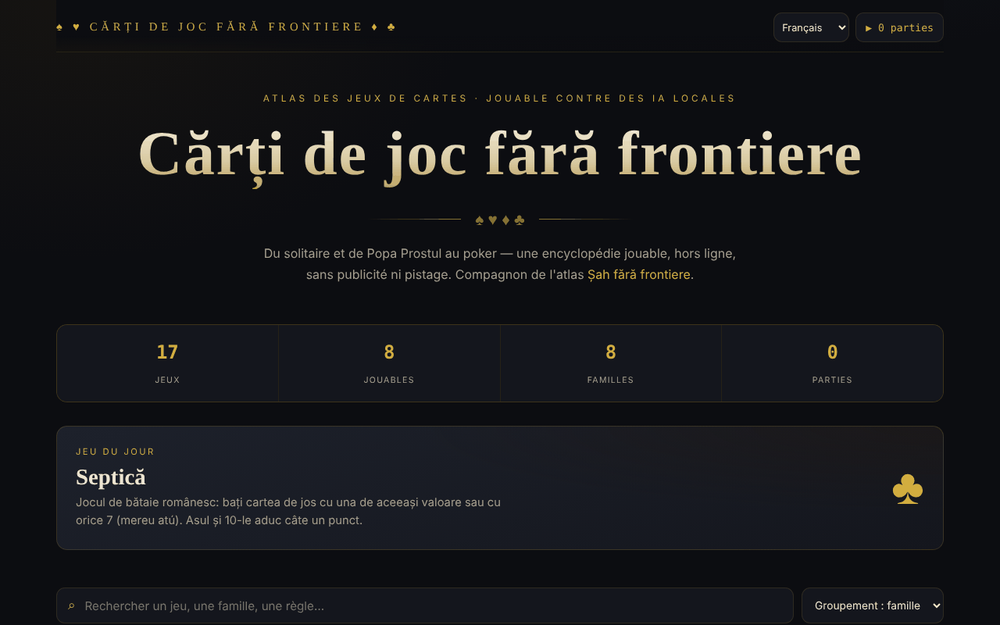

# Cărți de joc fără frontiere

[English](README.md) · [Română](README.ro.md) · **Français** · [Italiano](README.it.md) · [Español](README.es.md) · [Português](README.pt.md) · [Deutsch](README.de.md) · [Magyar](README.hu.md)

**Version :** 1.2.5 · **Dernière mise à jour :** 2026-10-22

Langues de l'interface : **Română, English, Français, Italiano, Español, Português (PT), Deutsch, Magyar**

Atlas de jeux de cartes avec huit jeux jouables, dans un seul fichier HTML.

**Application en ligne :** https://chiuta.github.io/Carti-de-joc-fara-frontiere/

## De quoi s'agit-il

Un atlas interactif de jeux de cartes, de la réussite (Solitaire) et du Popa Prostul (le Pouilleux) jusqu'au poker, décrit dans l'application comme une « encyclopédie jouable, hors ligne, sans publicité et sans pistage ». Le catalogue regroupe les jeux par familles ; chaque jeu a une fiche avec informations et règles, et certains peuvent être joués directement dans la page. Il est le compagnon de l'atlas « Șah fără frontiere » (Échecs sans frontières).

## Fonctionnalités

- Catalogue de 17 jeux, regroupés par familles : Pour enfants & rapides, Jeux roumains, Jeux de défausse, À levées, Combinaisons & rami, Famille du poker, Casino & paris, Patience (réussite).
- Huit jeux jouables (selon la note du pied de page) : Solitaire (Klondike), Bataille, Popa Prostul, Macao, Crazy Eights (Opt nebun, en tête-à-tête contre l'ordinateur), Septică, Blackjack et Texas Hold'em. Les autres sont documentés.
- Recherche dans les titres, descriptions, étiquettes et règles (« Cherchez un jeu, une famille, une règle… »).
- Tri : regroupement par familles, alphabétique A→Z, difficulté croissante, jouables d'abord.
- Filtres par familles, plus le filtre « ★ Jouables seulement ».
- Fiche de jeu avec nombre de joueurs, époque, difficulté ; marquage comme favori (★).
- Jeu du jour et compteur de statistiques (jeux, jouables, familles, parties jouées).
- Accessibilité à la table : noms des cartes en roumain et annonce des messages du jeu pour les lecteurs d'écran.
- Bouton **▶ Jouer** dans la fiche de chaque jeu jouable ; **Fermer** / ✕ / **Échap** pour sortir.

## Mode d'emploi

1. Ouvrez la page ; en haut, vous voyez les statistiques et le jeu du jour.
2. Cherchez dans le champ de recherche ou choisissez une famille parmi les puces ; changez l'ordre dans la liste de tri.
3. Cliquez sur un jeu pour ouvrir sa fiche avec les règles. Appuyez sur ★ dans la fiche pour le marquer comme favori.
4. Si le jeu est marqué « Jouable », appuyez sur **▶ Jouer** et suivez les indications de la table.
5. Fermez la fiche ou la table de jeu avec **Fermer**, ✕ ou **Échap**.
6. Le compteur « ▶ N parties » dans le coin supérieur indique combien de parties vous avez commencées.

## Avertissement

Les jeux (y compris le Blackjack et le Texas Hold'em, de la famille « Casino & paris ») sont des simulations éducatives avec des jetons virtuels ; aucun argent réel n'est misé. Les jeux d'argent peuvent créer une dépendance et sont destinés aux adultes. Les adversaires des jeux jouables sont des programmes locaux (l'application les appelle « IA locales ») ; l'application affiche une note en pied de page.

## Confidentialité et réseau

- **Stockage local (localStorage) :** deux clés préfixées `cff:`, `cff:fav` (les jeux favoris) et `cff:played` (le nombre de parties). Elles ne sont envoyées nulle part.
- **Réseau :** il n'y a ni requêtes `fetch`, ni scripts, polices ou images externes. La page ne comporte que des liens qui s'ouvrent au clic : Șah fără frontiere (alexio.tf), Buy Me a Coffee. La page a une politique CSP restrictive (`default-src 'self'`). Il n'y a pas de télémétrie.

## Exécution en local / hors ligne

Téléchargez `index.html` et ouvrez-le dans le navigateur ; il n'a pas besoin d'internet (les liens externes, si).

## Licence

Licence MIT — voir le fichier `LICENSE`. L'en-tête de `index.html` et le texte de l'interface indiquent la même licence (une mention antérieure « CC-BY-SA 4.0 » dans l'interface a été supprimée lors de l'audit, 2026-10-11, pour éliminer la contradiction).

## Marques

Les noms de jeux sont des dénominations commerciales de leurs détenteurs, utilisées à titre descriptif ; le projet n'est pas affilié à ceux-ci.

## Audit

Audit : 2026-10-10 — vérifié avec Playwright et axe-core (catalogue, fiches et tables des sept jeux d'alors) ; vérifié dans le code : pas de `fetch`, CSP `default-src 'self'`. Corrigé : une case à cocher décorative focalisable (axe serious) ; ajout d'un avertissement sur les jeux d'argent.

## Auteur

Alexio — Alexandru-Ionuț Chiuță, Centrul StrING (comme mentionné dans l'application). Contact : alexio@trom.tf

## Résumé

Cărți de joc fără frontiere est un atlas monofichier de 17 jeux de cartes regroupés par familles, avec recherche, tri, favoris et huit jeux jouables (Solitaire Klondike, Bataille, Popa Prostul, Macao, Crazy Eights, Septică, Blackjack, Texas Hold'em). Il ne stocke dans localStorage que les favoris et un compteur de parties jouées, et ne charge aucune ressource externe. L'interface est en roumain. Sous licence MIT (voir LICENSE).

## Nouveautés (v1.1.0)

- **Jeu à deux sur le réseau** (bouton « Jouer à deux, sur le réseau » dans la fiche Crazy Eights) : partie entre deux personnes, même donne pour les deux (graine commune), la main de l'adversaire reste cachée, les coups hors tour sont refusés. La connexion se fait directement entre les deux navigateurs (WebRTC), sans serveur de notre part : vous échangez deux textes (offre/réponse), sous forme de texte ou de code QR, par le canal de votre choix. Par défaut aucun serveur STUN n'est contacté ; on peut en saisir un manuellement dans la fenêtre de connexion, seulement si vous le souhaitez. Si la liaison est interrompue, l'application l'indique et peut reprendre la partie à partir du journal des coups.
- **Recherche locale** dans le catalogue de jeux (FFF.search) : trouve aussi sans diacritiques ou avec de petites fautes, dans le texte des règles et des descriptions ; sans réseau.
- **Lecture vocale** des règles (bouton « Écouter », FFF.tts), avec choix de la voix.
- Kit commun (core, label, bundle, qr, p2p, tts, search) : étiquette de version, sauvegarde .fff.json.
- Les nouveaux textes sont dans toutes les langues de l'application (y compris hu/de là où un système i18n existe) ; les traductions automatiques ne sont pas vérifiées par des locuteurs natifs.
- Tests : `tests/fff-r8.test.mjs` (réseau bloqué, deux contextes connectés via la vraie boîte de dialogue, axe 0 violation à 1280 et 360 px).

## Historique / Changelog

- 1.2.5 — 2026-10-22 : fff-kit 1.1.2 : PBKDF2 600 000 itérations, protection anti-clickjacking
- 1.2.4 — 2026-10-22: finitions mobile et accessibilité : texte d’au moins 12 px et cibles tactiles d’au moins 24 px. focus clavier visible sur chaque contrôle.
- 1.2.3 — 2026-10-22: Correctif de traduction : la description (et le nom) du panneau de transparence suivent désormais la langue de l'interface.
- 1.2.2 — 2026-10-22: **correctif** : le titre de la page et le titre principal suivent désormais la langue choisie.
### 14 octobre 2026 (v1.1.0)
- Nouveau : jeu à deux sur le réseau à Crazy Eights, recherche locale tolérante aux diacritiques et aux fautes, lecture vocale des règles, kit commun, tests.

### 12 octobre 2026 (v1.0.0)
- 1.0.0 — 2026-10-12 : la version et la date de dernière mise à jour sont affichées dans l'application

### 11 octobre 2026
- Les cartes sur la table ont désormais un nom accessible en roumain (« dame de cœur rouge », « 3 de carreau », « Carte retournée ») au lieu du texte des coins répété ; les cartes sur lesquelles on peut cliquer sont des boutons (rôle `button`, Entrée/Espace), les autres images (rôle `img`).
- Les messages de la table de jeu (« À vous de jouer. », « Choisissez la mise… ») sont annoncés aux lecteurs d'écran par une région live (vérifié sur Solitaire, Macao, Blackjack, Septică).
- Nouveau jeu jouable : **Crazy Eights (Opt nebun)**, en tête-à-tête contre l'ordinateur (7 cartes, 8 = joker avec choix de la couleur, pioche jusqu'à trouver une carte valide) ; testé avec 40 parties automatiques (52 cartes conservées, chaque partie s'est terminée). Désormais 8 jeux sur 17 sont jouables.
- CSP : `script-src` par hachage SHA-256 (deux scripts), sans `'unsafe-inline'`.
- Blackjack : ajout du **split** (une seule fois, cartes de même valeur ; l'as scindé ne reçoit qu'une seule carte), de l'**assurance** 2:1 lorsque le croupier montre un As, et du doublement sur toute main ; vérifié avec des mains fixes (gains, banque, égalités).
- Sur mobile, la pastille de dons est par défaut un petit bouton ♥ (qui se déploie au toucher) et la page a une marge en bas pour ne pas couvrir le contenu ; ses commandes sont désormais accessibles au clavier.
- Le contenu est encadré par `<main>`/`<header>` ; les fenêtres (fiche, table) ont le rôle de dialogue ; ordre des titres corrigé (axe : 0 violation).
