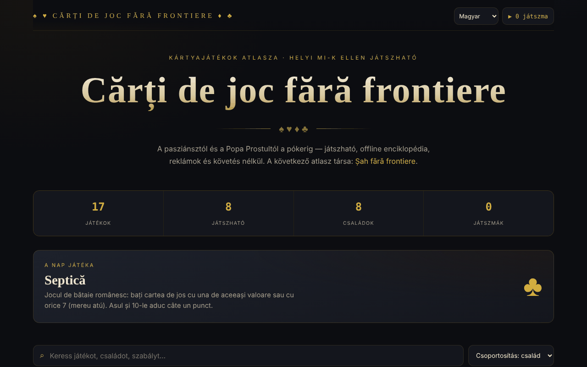

# Cărți de joc fără frontiere

[English](README.md) · [Română](README.ro.md) · [Français](README.fr.md) · [Italiano](README.it.md) · [Español](README.es.md) · [Português](README.pt.md) · [Deutsch](README.de.md) · **Magyar**

**Verzió:** 2.1.0 · **Utolsó frissítés:** 2026-10-27

A felület nyelvei: **Română, English, Français, Italiano, Español, Português (PT), Deutsch, Magyar**

Kártyajátékok atlasza nyolc játszható játékkal, egyetlen HTML-fájlban.

**Online alkalmazás:** https://chiuta.github.io/Carti-de-joc-fara-frontiere/

## Mi ez

Kártyajátékok interaktív atlasza a pasziánsztól és a Popa Prostultól (Fekete Péter) a pókerig, amelyet az alkalmazás „játszható enciklopédiaként, offline, reklámok és követés nélkül” ír le. A katalógus családok szerint csoportosítja a játékokat; minden játékhoz tartozik egy lap információkkal és szabályokkal, és néhányat közvetlenül az oldalon is lehet játszani. A „Șah fără frontiere” (Sakk határok nélkül) atlasz társa.

## Funkciók

- 17 játékból álló katalógus, családokba csoportosítva: Gyerekeknek és gyors játékok, Román játékok, Kiszálló (lerakós) játékok, Ütésjátékok, Kombinációk és römi, A póker családja, Kaszinó és fogadás, Pasziánsz.
- Nyolc játszható játék (a lábléc megjegyzése szerint): Pasziánsz (Klondike), Háború, Popa Prostul, Macao, Crazy Eights (Opt nebun, egy az egy ellen a számítógép ellen), Septică, Blackjack és Texas Hold'em. A többi dokumentált.
- Keresés a címekben, leírásokban, címkékben és szabályokban („Keress egy játékot, egy családot, egy szabályt…”).
- Rendezés: csoportosítás családok szerint, ábécé szerint A→Z, növekvő nehézség, először a játszhatók.
- Szűrők családok szerint, valamint a „★ Csak játszhatók” szűrő.
- Játéklap a játékosok számával, korszakkal, nehézséggel; megjelölés kedvencként (★).
- A nap játéka és statisztikai számláló (játékok, játszhatók, családok, lejátszott partik).
- Akadálymentesség az asztalnál: a kártyák nevei románul, és a játéküzenetek bemondása képernyőolvasók számára.
- **▶ Játék** gomb minden játszható játék lapján; **Bezárás** / ✕ / **Esc** a kilépéshez.

## Használati útmutató

1. Nyisd meg az oldalt; fent látod a statisztikákat és a nap játékát.
2. Keress a keresőmezőben, vagy válassz egy családot a címkék közül; módosítsd a sorrendet a rendezési listában.
3. Kattints egy játékra a szabályokat tartalmazó lap megnyitásához. Nyomd meg a lapon a ★ gombot a kedvencként való megjelöléshez.
4. Ha a játék „Játszható” jelölésű, nyomd meg a **▶ Játék** gombot, és kövesd az asztalon megjelenő utasításokat.
5. Zárd be a lapot vagy a játékasztalt a **Bezárás**, a ✕ vagy az **Esc** segítségével.
6. A felső sarokban lévő „▶ N parti” számláló mutatja, hány partit kezdtél el.

## Figyelmeztetés

A játékok (köztük a Blackjack és a Texas Hold'em, a „Kaszinó és fogadás” családból) oktató jellegű szimulációk virtuális zsetonokkal; valódi pénzt nem tesznek meg. A pénzben játszott szerencsejáték függőséget okozhat, és felnőtteknek szól. A játszható játékokban az ellenfelek helyi programok (az alkalmazás „helyi MI-knek” nevezi őket); az alkalmazás megjegyzést jelenít meg a láblécben.

## Adatvédelem és hálózat

- **Helyi tárolás (localStorage):** két `carti-de-joc.` előtagú kulcs: `carti-de-joc.fav` (a kedvenc játékok) és `carti-de-joc.played` (a partik száma). Sehová nem kerülnek elküldésre.
- **Hálózat:** nincsenek `fetch` kérések, külső szkriptek, betűtípusok vagy képek. Az oldal csak kattintásra megnyíló hivatkozásokat tartalmaz: Șah fără frontiere (alexio.tf), Buy Me a Coffee. Az oldalon szigorú CSP-szabály van érvényben (`default-src 'self'`). Nincs telemetria.

## Futtatás helyben / offline

Töltsd le az `index.html` fájlt, és nyisd meg a böngészőben; nincs szüksége internetre (a külső hivatkozásoknak van).

## Licenc

MIT licenc — lásd a `LICENSE` fájlt. Az `index.html` fejléce és a felületen lévő szöveg ugyanazt a licencet jelzi (a felületen korábban szereplő „CC-BY-SA 4.0” említést az auditkor, 2026-10-11-én eltávolítottuk az ellentmondás megszüntetése érdekében).

## Védjegyek

A játékok nevei tulajdonosaik kereskedelmi megnevezései, leíró jelleggel használva; a projekt nem áll kapcsolatban velük.

## Audit

Audit: 2026-10-10 — Playwright-tal és axe-core-ral ellenőrizve (a katalógus, a lapok és az akkori hét játék asztalai); a kódban ellenőrizve: nincs `fetch`, CSP `default-src 'self'`. Javítva: egy dekoratív, fókuszálható jelölőnégyzet (axe serious); hozzáadva egy figyelmeztetés a szerencsejátékokról.

## Szerző

Alexio — Alexandru-Ionuț Chiuță, Centrul StrING (az alkalmazásban említettek szerint). Kapcsolat: alexio@trom.tf

## Összefoglaló

A Cărți de joc fără frontiere egyetlen fájlból álló atlasz 17, családok szerint csoportosított kártyajátékkal, kereséssel, rendezéssel, kedvencekkel és nyolc játszható játékkal (Klondike pasziánsz, Háború, Popa Prostul, Macao, Crazy Eights, Septică, Blackjack, Texas Hold'em). A localStorage-ban csak a kedvenceket és a lejátszott partik számlálóját tárolja, és nem tölt be külső erőforrásokat. A felület román nyelvű. MIT licenc (lásd a LICENSE fájlt).

## Újdonságok (v1.1.0)

- **Kétszemélyes játék hálózaton** (a „Játék kettesben, hálózaton” gomb a Crazy Eights lapján): meccs két ember között, mindkettőjüknek ugyanaz a leosztás (közös mag), az ellenfél keze rejtve marad, a sorrenden kívüli lépéseket elutasítja. A kapcsolat közvetlenül a két böngésző között jön létre (WebRTC), a mi szerverünk nélkül: két szöveget cseréltek (ajánlat/válasz), szövegként vagy QR-kódként, tetszőleges csatornán. Alapértelmezés szerint nem veszi fel a kapcsolatot egyetlen STUN-kiszolgálóval sem; egyet kézzel meg lehet adni a csatlakozási ablakban, csak ha szeretnéd. Ha a kapcsolat megszakad, az alkalmazás jelzi, és a lépésnapló alapján folytatni tudja a játékot.
- **Helyi keresés** a játékkatalógusban (FFF.search): ékezetek nélkül vagy apró elírásokkal is talál, a szabályok és leírások szövegében; hálózat nélkül.
- A szabályok **felolvasása** („Meghallgatás” gomb, FFF.tts), hangválasztással.
- Közös készlet (core, label, bundle, qr, p2p, tts, search): verziócímke, .fff.json biztonsági mentés.
- Az új szövegek az alkalmazás minden nyelvén megvannak (beleértve a hu/de nyelvet is, ahol van i18n-rendszer); az automatikus fordításokat anyanyelvi beszélők nem ellenőrizték.
- Tesztek: `tests/fff-r8.test.mjs` (blokkolt hálózat, két, a valódi párbeszédablakon át összekapcsolt környezet, axe 0 hiba 1280 és 360 px-en).

## Előzmények / Changelog

- 1.2.9 — 2026-10-23: Fix: in networked Crazy Eights, a move with an invalid suit (e.g. 1.5) after an 8 is now rejected (it used to be accepted); CSP hash recalculated.
- 1.2.8 — 2026-10-23: A tárolókulcsok mostantól az alkalmazás előtagját viselik (`carti-de-joc.lang`, `carti-de-joc.fav`, `carti-de-joc.played`); a meglévő adatok (nyelv, kedvencek, lejátszott körök) indításkor automatikusan átkerülnek, a régi `.fff.json` másolatok továbbra is importálhatók. fff-kit 1.2.0: előtag nélküli tárolás javítva
- 1.2.6 — 2026-10-22: fff-kit 1.1.4: érintési célpontok és minimális szövegméret
- 1.2.5 — 2026-10-22: fff-kit 1.1.2: PBKDF2 600 000 iteráció, clickjacking elleni védelem
- 1.2.4 — 2026-10-22: mobil és kisegítő finomítások: legalább 12 px-es szöveg és legalább 24 px-es érintési felületek. látható billentyűzetfókusz minden vezérlőn.
- 1.2.3 — 2026-10-22: Fordítási javítás: az átláthatósági panel leírása (és neve) mostantól a felület nyelvét követi.
- 1.2.2 — 2026-10-22: **javítás**: az oldal címe és a főcím mostantól a kiválasztott nyelvet követi.
### 2026. október 14. (v1.1.0)
- Új: kétszemélyes hálózati játék a Crazy Eightsben, ékezetekre és elírásokra toleráns helyi keresés, a szabályok felolvasása, közös készlet, tesztek.

### 2026. október 12. (v1.0.0)
- 1.0.0 — 2026-10-12: a verzió és az utolsó frissítés dátuma megjelenik az alkalmazásban

### 2026. október 11.
- Az asztalon lévő kártyák most hozzáférhető román nevet kapnak („piros kőr dáma”, „káró 3”, „Lefordított lap”) az ismételt sarokszöveg helyett; a rákattintható kártyák gombok (`button` szerep, Enter/Szóköz), a többi kép (`img` szerep).
- A játékasztal üzeneteit („Te jössz.”, „Válaszd ki a tétet…”) egy élő régió (live region) mondja be a képernyőolvasóknak (ellenőrizve a Pasziánsz, Macao, Blackjack, Septică játékokon).
- Új játszható játék: **Crazy Eights (Opt nebun)**, egy az egy ellen a számítógép ellen (7 lap, 8 = joker színválasztással, húzás addig, amíg érvényes lapot találsz); 40 automatikus partival tesztelve (52 lap megmaradt, minden parti befejeződött). Most a 17 játékból 8 játszható.
- CSP: `script-src` SHA-256 hash alapján (két szkript), `'unsafe-inline'` nélkül.
- Blackjack: hozzáadva a **split** (csak egyszer, azonos értékű lapokkal; a megosztott ász csak egy lapot kap), a **biztosítás** 2:1 arányban, amikor az osztó ászt mutat, és a duplázás bármelyik leosztásnál; rögzített leosztásokkal ellenőrizve (kifizetések, bank, döntetlenek).
- Mobilon az adományozó pirula alapértelmezetten egy kis ♥ gomb (érintésre kinyílik), és az oldalnak alsó margója van, hogy ne takarja el a tartalmat; a vezérlői most már billentyűzettel is elérhetők.
- A tartalom `<main>`/`<header>` elembe van foglalva; az ablakok (lap, asztal) párbeszédablak szerepet kapnak; a címsorrend javítva (axe: 0 hiba).
