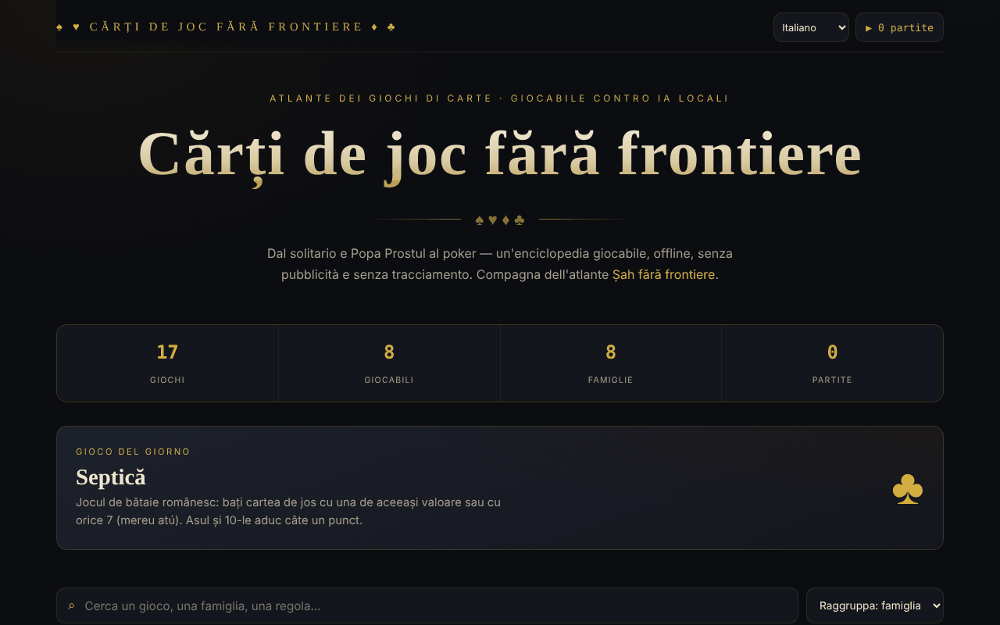

# Cărți de joc fără frontiere

[English](README.md) · [Română](README.ro.md) · [Français](README.fr.md) · **Italiano** · [Español](README.es.md) · [Português](README.pt.md) · [Deutsch](README.de.md) · [Magyar](README.hu.md)

**Versione:** 1.2.10 · **Ultimo aggiornamento:** 2026-10-26

Lingue dell'interfaccia: **Română, English, Français, Italiano, Español, Português (PT), Deutsch, Magyar**

Atlante di giochi di carte con otto giochi giocabili, in un unico file HTML.

**Applicazione online:** https://chiuta.github.io/Carti-de-joc-fara-frontiere/

## Che cos'è

Un atlante interattivo di giochi di carte, dal Solitario e dal Popa Prostul (il Vecchio Maggiore) fino al poker, descritto nell'applicazione come «enciclopedia giocabile, offline, senza pubblicità e senza tracciamento». Il catalogo raggruppa i giochi per famiglie; per ogni gioco c'è una scheda con informazioni e regole, e alcuni possono essere giocati direttamente nella pagina. È il compagno dell'atlante «Șah fără frontiere» (Scacchi senza frontiere).

## Funzionalità

- Catalogo di 17 giochi, raggruppati in famiglie: Per bambini e veloci, Giochi rumeni, Giochi di scarto, A prese, Combinazioni e ramino, Famiglia del poker, Casinò e scommesse, Pazienza (solitario).
- Otto giochi giocabili (secondo la nota a piè di pagina): Solitario (Klondike), Guerra, Popa Prostul, Macao, Crazy Eights (Opt nebun, 1 contro 1 con il computer), Septică, Blackjack e Texas Hold'em. Gli altri sono documentati.
- Ricerca in titoli, descrizioni, etichette e regole («Cerca un gioco, una famiglia, una regola…»).
- Ordinamento: raggruppamento per famiglie, alfabetico A→Z, difficoltà crescente, prima i giocabili.
- Filtri per famiglie, più il filtro «★ Solo giocabili».
- Scheda del gioco con numero di giocatori, epoca, difficoltà; contrassegno come preferito (★).
- Gioco del giorno e contatore di statistiche (giochi, giocabili, famiglie, partite giocate).
- Accessibilità al tavolo: nomi delle carte in rumeno e annuncio dei messaggi di gioco per gli screen reader.
- Pulsante **▶ Gioca** nella scheda di ogni gioco giocabile; **Chiudi** / ✕ / **Esc** per uscire.

## Guida all'uso

1. Apri la pagina; in alto vedi le statistiche e il gioco del giorno.
2. Cerca nel campo di ricerca o scegli una famiglia dai chip; cambia l'ordine dalla lista di ordinamento.
3. Fai clic su un gioco per aprire la scheda con le regole. Premi ★ nella scheda per contrassegnarlo come preferito.
4. Se il gioco è contrassegnato come «Giocabile», premi **▶ Gioca** e segui le indicazioni sul tavolo.
5. Chiudi la scheda o il tavolo di gioco con **Chiudi**, ✕ o **Esc**.
6. Il contatore «▶ N partite» nell'angolo in alto mostra quante partite hai iniziato.

## Avvertenza

I giochi (compresi Blackjack e Texas Hold'em, della famiglia «Casinò e scommesse») sono simulazioni educative con gettoni virtuali; non si scommette denaro reale. Il gioco d'azzardo con denaro può creare dipendenza ed è destinato agli adulti. Gli avversari nei giochi giocabili sono programmi locali (l'applicazione li chiama «IA locali»); l'applicazione mostra una nota a piè di pagina.

## Privacy e rete

- **Archiviazione locale (localStorage):** due chiavi con prefisso `carti-de-joc.`, `carti-de-joc.fav` (i giochi preferiti) e `carti-de-joc.played` (il numero di partite). Non vengono inviate da nessuna parte.
- **Rete:** non ci sono richieste `fetch`, script, font o immagini esterni. La pagina include solo link che si aprono al clic: Șah fără frontiere (alexio.tf), Buy Me a Coffee. La pagina ha una policy CSP restrittiva (`default-src 'self'`). Non c'è telemetria.

## Esecuzione in locale / offline

Scarica `index.html` e aprilo nel browser; non ha bisogno di internet (i link esterni sì).

## Licenza

Licenza MIT — vedi il file `LICENSE`. L'intestazione di `index.html` e il testo dell'interfaccia indicano la stessa licenza (una precedente menzione «CC-BY-SA 4.0» nell'interfaccia è stata rimossa durante l'audit, 2026-10-11, per eliminare la contraddizione).

## Marchi

I nomi dei giochi sono denominazioni commerciali dei rispettivi titolari, usate a scopo descrittivo; il progetto non è affiliato ad essi.

## Audit

Audit: 2026-10-10 — verificato con Playwright e axe-core (catalogo, schede e tavoli dei sette giochi di allora); verificato nel codice: nessun `fetch`, CSP `default-src 'self'`. Corretto: una checkbox decorativa focalizzabile (axe serious); aggiunta un'avvertenza sul gioco d'azzardo.

## Autore

Alexio — Alexandru-Ionuț Chiuță, Centrul StrING (come indicato nell'applicazione). Contatto: alexio@trom.tf

## Riepilogo

Cărți de joc fără frontiere è un atlante in un unico file di 17 giochi di carte raggruppati per famiglie, con ricerca, ordinamento, preferiti e otto giochi giocabili (Solitario Klondike, Guerra, Popa Prostul, Macao, Crazy Eights, Septică, Blackjack, Texas Hold'em). Memorizza in localStorage solo i preferiti e un contatore delle partite giocate e non carica risorse esterne. L'interfaccia è in rumeno. Con licenza MIT (vedi LICENSE).

## Novità (v1.1.0)

- 1.2.5 — 2026-10-22: fff-kit 1.1.2: PBKDF2 600.000 iterazioni, protezione anti-clickjacking
- **Gioco in due in rete** (pulsante «Gioca in due, in rete» nella scheda di Crazy Eights): partita tra due persone, stessa distribuzione per entrambi (seme comune), la mano dell'avversario resta nascosta, le mosse fuori turno vengono respinte. La connessione avviene direttamente tra i due browser (WebRTC), senza un nostro server: si scambiano due testi (offerta/risposta), come testo o codice QR, attraverso un canale a tua scelta. Per impostazione predefinita non viene contattato alcun server STUN; se ne può inserire uno manualmente nella finestra di connessione, solo se lo desideri. Se il collegamento si interrompe, l'applicazione lo segnala e può riprendere la partita dal registro delle mosse.
- **Ricerca locale** nel catalogo dei giochi (FFF.search): trova anche senza segni diacritici o con piccoli errori, nel testo delle regole e delle descrizioni; senza rete.
- **Lettura vocale** delle regole (pulsante «Ascolta», FFF.tts), con scelta della voce.
- Kit comune (core, label, bundle, qr, p2p, tts, search): etichetta di versione, copia .fff.json.
- I nuovi testi sono in tutte le lingue dell'applicazione (compresi hu/de dove esiste un sistema i18n); le traduzioni automatiche non sono verificate da madrelingua.
- Test: `tests/fff-r8.test.mjs` (rete bloccata, due contesti collegati tramite la vera finestra di dialogo, axe 0 violazioni a 1280 e 360 px).

## Cronologia / Changelog

- 1.2.9 — 2026-10-23: Fix: in networked Crazy Eights, a move with an invalid suit (e.g. 1.5) after an 8 is now rejected (it used to be accepted); CSP hash recalculated.
- 1.2.8 — 2026-10-23: Le chiavi di archiviazione hanno ora il prefisso dell'app (`carti-de-joc.lang`, `carti-de-joc.fav`, `carti-de-joc.played`); i dati esistenti (lingua, preferiti, partite giocate) vengono migrati automaticamente all'avvio e le vecchie copie `.fff.json` si possono ancora importare. fff-kit 1.2.0: archiviazione senza prefisso corretta
- 1.2.6 — 2026-10-22: fff-kit 1.1.4: target touch e dimensione minima del testo
- 1.2.4 — 2026-10-22: rifiniture per mobile e accessibilità: testo di almeno 12 px e aree tattili di almeno 24 px. focus da tastiera visibile su ogni controllo.
- 1.2.3 — 2026-10-22: Correzione di traduzione: la descrizione (e il nome) nel pannello di trasparenza seguono ora la lingua dell'interfaccia.
- 1.2.2 — 2026-10-22: **correzione**: il titolo della pagina e il titolo principale seguono ora la lingua scelta.
### 14 ottobre 2026 (v1.1.0)
- Novità: gioco in due in rete a Crazy Eights, ricerca locale tollerante a segni diacritici ed errori, lettura vocale delle regole, kit comune, test.

### 12 ottobre 2026 (v1.0.0)
- 1.0.0 — 2026-10-12: la versione e la data dell'ultimo aggiornamento sono mostrate nell'applicazione

### 11 ottobre 2026
- Le carte sul tavolo hanno ora un nome accessibile in rumeno («donna di cuori rossa», «3 di quadri», «Carta coperta») invece del testo degli angoli ripetuto; le carte su cui si può fare clic sono pulsanti (ruolo `button`, Invio/Spazio), le altre immagini (ruolo `img`).
- I messaggi del tavolo di gioco («Tocca a te.», «Scegli la puntata…») sono annunciati agli screen reader tramite una regione live (verificato su Solitario, Macao, Blackjack, Septică).
- Nuovo gioco giocabile: **Crazy Eights (Opt nebun)**, 1 contro 1 con il computer (7 carte, 8 = jolly con scelta del seme, si pesca finché non si trova una carta valida); testato con 40 partite automatiche (52 carte conservate, ogni partita si è conclusa). Ora 8 giochi su 17 sono giocabili.
- CSP: `script-src` tramite hash SHA-256 (due script), senza `'unsafe-inline'`.
- Blackjack: aggiunti **split** (una sola volta, carte dello stesso valore; l'asso diviso riceve una sola carta), **assicurazione** 2:1 quando il mazziere mostra un Asso e raddoppio su qualsiasi mano; verificato con mani fisse (pagamenti, banco, pareggi).
- Su mobile la pillola delle donazioni è per impostazione predefinita un piccolo pulsante ♥ (si espande al tocco) e la pagina ha un margine in basso per non coprire il contenuto; i suoi controlli sono ora accessibili da tastiera.
- Il contenuto è racchiuso in `<main>`/`<header>`; le finestre (scheda, tavolo) hanno il ruolo di dialogo; ordine dei titoli corretto (axe: 0 violazioni).
