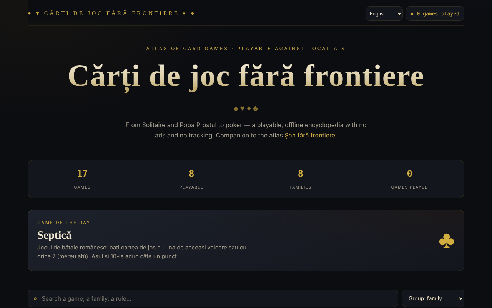

# Cărți de joc fără frontiere

**English** · [Română](README.ro.md) · [Français](README.fr.md) · [Italiano](README.it.md) · [Español](README.es.md) · [Português](README.pt.md) · [Deutsch](README.de.md) · [Magyar](README.hu.md)

**Version:** 1.2.2 · **Last updated:** 2026-10-22

Interface languages: **Română, English, Français, Italiano, Español, Português (PT), Deutsch, Magyar**

An atlas of card games with eight playable games, in a single HTML file.

**Live app:** https://chiuta.github.io/Carti-de-joc-fara-frontiere/

## What it is

An interactive atlas of card games, from Solitaire and Popa Prostul (Old Maid) to poker, described in the app as a "playable encyclopedia, offline, with no ads and no tracking". The catalogue groups the games by family; each game has a sheet with information and rules, and some of them can be played right in the page. It is the companion of the atlas "Șah fără frontiere" (Chess Without Borders).

## Features

- A catalogue of 17 games, grouped into families: For children & quick games, Romanian games, Shedding games, Trick-taking, Combinations & rummy, The poker family, Casino & betting, Patience (solitaire).
- Eight playable games (according to the footer note): Solitaire (Klondike), War, Popa Prostul, Macao, Crazy Eights (Opt nebun, 1-on-1 against the computer), Septică, Blackjack and Texas Hold'em. The rest are documented.
- Search in titles, descriptions, tags and rules ("Search for a game, a family, a rule…").
- Sorting: grouped by family, alphabetical A→Z, increasing difficulty, playable first.
- Filters by family, plus the "★ Playable only" filter.
- Game sheet with number of players, era, difficulty; marking as a favourite (★).
- Game of the day and a statistics counter (games, playable, families, rounds played).
- Accessibility at the table: card names in Romanian and announcement of game messages for screen readers.
- A **▶ Play** button on the sheet of every playable game; **Close** / ✕ / **Esc** to exit.

## User guide

1. Open the page; at the top you see the statistics and the game of the day.
2. Search in the search field or choose a family from the chips; change the order from the sort list.
3. Click a game to open its sheet with the rules. Press ★ in the sheet to mark it as a favourite.
4. If the game is marked "Playable", press **▶ Play** and follow the instructions on the table.
5. Close the sheet or the game table with **Close**, ✕ or **Esc**.
6. The "▶ N rounds" counter in the top corner shows how many rounds you have started.

## Warning

The games (including Blackjack and Texas Hold'em, from the "Casino & betting" family) are educational simulations with virtual chips; no real money is wagered. Gambling for money can be addictive and is intended for adults. The opponents in the playable games are local programs (the app calls them "local AIs"); the app displays a note in the footer.

## Privacy and network

- **Local storage (localStorage):** two keys with the prefix `cff:`, `cff:fav` (favourite games) and `cff:played` (the number of rounds). They are not sent anywhere.
- **Network:** there are no `fetch` requests, scripts, fonts or external images. The page includes only links that open on click: Șah fără frontiere (alexio.tf), Buy Me a Coffee. The page has a restrictive CSP policy (`default-src 'self'`). There is no telemetry.

## Running locally / offline

Download `index.html` and open it in the browser; it does not need internet (the external links do).

## License

MIT License — see the `LICENSE` file. The header in `index.html` and the text in the interface indicate the same license (an earlier "CC-BY-SA 4.0" mention in the interface was removed at the audit, 2026-10-11, to eliminate the contradiction).

## Trademarks

Game names are trade names of their owners, used descriptively; the project is not affiliated with them.

## Audit

Audit: 2026-10-10 — verified with Playwright and axe-core (catalogue, sheets and the tables of the seven games at that time); verified in the code: no `fetch`, CSP `default-src 'self'`. Fixed: a decorative focusable checkbox (axe serious); added a warning about gambling games.

## Author

Alexio — Alexandru-Ionuț Chiuță, Centrul StrING (as mentioned in the app). Contact: alexio@trom.tf

## Summary

Cărți de joc fără frontiere is a single-file atlas of 17 card games grouped by family, with search, sorting, favourites and eight playable games (Klondike Solitaire, War, Popa Prostul, Macao, Crazy Eights, Septică, Blackjack, Texas Hold'em). It stores only favourites and a played-games counter in localStorage and loads no external resources. UI is in Romanian. Licensed MIT (see LICENSE).

## New features (v1.1.0)

- **Two-player game over the network** (the "Play two-player, over the network" button in the Crazy Eights sheet): a match between two people, the same deal for both (shared seed), the opponent's hand stays hidden, out-of-turn moves are rejected. The connection is made directly between the two browsers (WebRTC), with no server of ours: you exchange two texts (offer/answer), as text or QR code, through any channel of your choice. By default no STUN server is contacted; one can be entered manually in the connection window, only if you want it. If the link is interrupted, the app shows it and can resume the game from the move log.
- **Local search** in the game catalogue (FFF.search): finds results even without diacritics or with small typos, in the text of the rules and descriptions; no network.
- **Voice reading** of the rules ("Listen" button, FFF.tts), with a choice of voice.
- Shared kit (core, label, bundle, qr, p2p, tts, search): version label, .fff.json backup.
- The new texts are in all the app's languages (including hu/de where an i18n system exists); the automatic translations are not verified by native speakers.
- Tests: `tests/fff-r8.test.mjs` (network blocked, two contexts connected through the real dialog, axe 0 violations at 1280 and 360 px).

## History / Changelog

- 1.2.2 — 2026-10-22: **fix**: the page title and the main heading now follow the selected language.
### 14 October 2026 (v1.1.0)
- New: two-player network game in Crazy Eights, local search tolerant of diacritics and typos, voice reading of the rules, shared kit, tests.

### 12 October 2026 (v1.0.0)
- 1.0.0 — 2026-10-12: the version and the date of the last update are shown in the app

### 11 October 2026
- The cards on the table now have an accessible name in Romanian ("queen of hearts", "3 of diamonds", "Face-down card") instead of the repeated corner text; cards that can be clicked are buttons (role `button`, Enter/Space), the other images (role `img`).
- The game table messages ("Your turn.", "Choose the stake…") are announced to screen readers through a live region (verified on Solitaire, Macao, Blackjack, Septică).
- New playable game: **Crazy Eights (Opt nebun)**, 1-on-1 against the computer (7 cards, 8 = wild with colour choice, draw until you find a valid card); tested with 40 automated games (52 cards conserved, every game finished). Now 8 of the 17 games are playable.
- CSP: `script-src` by SHA-256 hash (two scripts), without `'unsafe-inline'`.
- Blackjack: added **split** (only once, cards of equal value; a split ace receives only one card), **insurance** 2:1 when the dealer shows an Ace, and doubling on any hand; verified with fixed hands (payouts, bank, ties).
- On mobile the donation pill is by default a small ♥ button (it expands on touch) and the page has a bottom margin so that it does not cover the content; its controls are now keyboard-accessible.
- The content is wrapped in `<main>`/`<header>`; the windows (sheet, table) have the dialog role; heading order corrected (axe: 0 violations).
