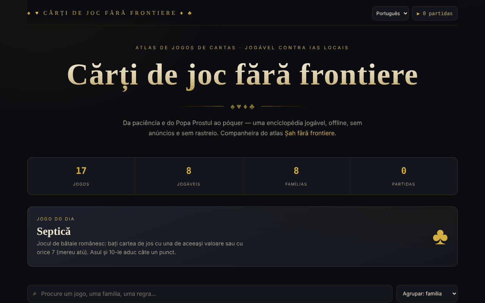

# Cărți de joc fără frontiere

[English](README.md) · [Română](README.ro.md) · [Français](README.fr.md) · [Italiano](README.it.md) · [Español](README.es.md) · **Português** · [Deutsch](README.de.md) · [Magyar](README.hu.md)

**Versão:** 1.2.10 · **Última atualização:** 2026-10-26

Idiomas da interface: **Română, English, Français, Italiano, Español, Português (PT), Deutsch, Magyar**

Atlas de jogos de cartas com oito jogos jogáveis, num único ficheiro HTML.

**Aplicação online:** https://chiuta.github.io/Carti-de-joc-fara-frontiere/

## O que é

Um atlas interativo de jogos de cartas, da Paciência e do Popa Prostul (o Mono, «Old Maid») ao póquer, descrito na aplicação como «enciclopédia jogável, offline, sem anúncios e sem rastreio». O catálogo agrupa os jogos por famílias; para cada jogo existe uma ficha com informações e regras, e alguns podem ser jogados diretamente na página. É o complemento do atlas «Șah fără frontiere» (Xadrez sem fronteiras).

## Funcionalidades

- Catálogo de 17 jogos, agrupados em famílias: Para crianças e rápidos, Jogos romenos, De descarte, De vazas, Combinações e rummy, Família do póquer, Casino e apostas, Paciência (solitário).
- Oito jogos jogáveis (segundo a nota do rodapé): Paciência (Klondike), Guerra, Popa Prostul, Macao, Crazy Eights (Opt nebun, 1 contra 1 com o computador), Septică, Blackjack e Texas Hold'em. Os restantes estão documentados.
- Pesquisa em títulos, descrições, etiquetas e regras («Procure um jogo, uma família, uma regra…»).
- Ordenação: agrupamento por famílias, alfabética A→Z, dificuldade crescente, jogáveis primeiro.
- Filtros por famílias, mais o filtro «★ Só jogáveis».
- Ficha de jogo com número de jogadores, época, dificuldade; marcação como favorito (★).
- Jogo do dia e contador de estatísticas (jogos, jogáveis, famílias, partidas jogadas).
- Acessibilidade à mesa: nomes das cartas em romeno e anúncio das mensagens do jogo para leitores de ecrã.
- Botão **▶ Jogar** na ficha de cada jogo jogável; **Fechar** / ✕ / **Esc** para sair.

## Manual de utilização

1. Abra a página; em cima vê as estatísticas e o jogo do dia.
2. Pesquise no campo de pesquisa ou escolha uma família nos chips; mude a ordem na lista de ordenação.
3. Clique num jogo para abrir a ficha com as regras. Prima ★ na ficha para o marcar como favorito.
4. Se o jogo estiver marcado como «Jogável», prima **▶ Jogar** e siga as indicações da mesa.
5. Feche a ficha ou a mesa de jogo com **Fechar**, ✕ ou **Esc**.
6. O contador «▶ N partidas» no canto superior mostra quantas partidas iniciou.

## Aviso

Os jogos (incluindo Blackjack e Texas Hold'em, da família «Casino e apostas») são simulações educativas com fichas virtuais; não se aposta dinheiro real. Os jogos de azar a dinheiro podem criar dependência e destinam-se a adultos. Os adversários nos jogos jogáveis são programas locais (a aplicação chama-lhes «IA locais»); a aplicação apresenta uma nota no rodapé.

## Privacidade e rede

- **Armazenamento local (localStorage):** duas chaves com o prefixo `carti-de-joc.`, `carti-de-joc.fav` (os jogos favoritos) e `carti-de-joc.played` (o número de partidas). Não são enviadas para lado nenhum.
- **Rede:** não existem pedidos `fetch`, scripts, tipos de letra nem imagens externos. A página inclui apenas ligações que se abrem ao clicar: Șah fără frontiere (alexio.tf), Buy Me a Coffee. A página tem uma política CSP restritiva (`default-src 'self'`). Não há telemetria.

## Execução local / offline

Descarregue `index.html` e abra-o no navegador; não precisa de internet (as ligações externas precisam).

## Licença

Licença MIT — veja o ficheiro `LICENSE`. O cabeçalho de `index.html` e o texto da interface indicam a mesma licença (uma menção anterior a «CC-BY-SA 4.0» na interface foi removida na auditoria, 2026-10-11, para eliminar a contradição).

## Marcas

Os nomes de jogos são designações comerciais dos seus titulares, usadas de forma descritiva; o projeto não é afiliado a estes.

## Auditoria

Auditoria: 2026-10-10 — verificado com Playwright e axe-core (catálogo, fichas e mesas dos sete jogos de então); verificado no código: sem `fetch`, CSP `default-src 'self'`. Corrigido: uma caixa de seleção decorativa focável (axe serious); adicionado um aviso sobre os jogos de azar.

## Autor

Alexio — Alexandru-Ionuț Chiuță, Centrul StrING (conforme indicado na aplicação). Contacto: alexio@trom.tf

## Resumo

Cărți de joc fără frontiere é um atlas de ficheiro único com 17 jogos de cartas agrupados por famílias, com pesquisa, ordenação, favoritos e oito jogos jogáveis (Paciência Klondike, Guerra, Popa Prostul, Macao, Crazy Eights, Septică, Blackjack, Texas Hold'em). Guarda no localStorage apenas os favoritos e um contador de partidas jogadas, e não carrega recursos externos. A interface está em romeno. Licença MIT (veja LICENSE).

## Novidades (v1.1.0)

- **Jogo a dois em rede** (botão «Jogar a dois, em rede» na ficha de Crazy Eights): partida entre duas pessoas, a mesma distribuição para ambas (semente comum), a mão do adversário permanece oculta, as jogadas fora de vez são recusadas. A ligação faz-se diretamente entre os dois navegadores (WebRTC), sem servidor nosso: trocam-se dois textos (oferta/resposta), como texto ou código QR, por qualquer canal à sua escolha. Por predefinição não é contactado nenhum servidor STUN; pode introduzir-se um manualmente na janela de ligação, apenas se o desejar. Se a ligação se interromper, a aplicação mostra-o e pode retomar o jogo a partir do registo de jogadas.
- **Pesquisa local** no catálogo de jogos (FFF.search): encontra também sem sinais diacríticos ou com pequenos erros, no texto das regras e das descrições; sem rede.
- **Leitura em voz alta** das regras (botão «Ouvir», FFF.tts), com escolha da voz.
- Kit comum (core, label, bundle, qr, p2p, tts, search): etiqueta de versão, cópia .fff.json.
- Os textos novos estão em todos os idiomas da aplicação (incluindo hu/de onde existe um sistema i18n); as traduções automáticas não estão verificadas por falantes nativos.
- Testes: `tests/fff-r8.test.mjs` (rede bloqueada, dois contextos ligados através do diálogo real, axe 0 violações a 1280 e 360 px).

## Histórico / Changelog

- 1.2.9 — 2026-10-23: Fix: in networked Crazy Eights, a move with an invalid suit (e.g. 1.5) after an 8 is now rejected (it used to be accepted); CSP hash recalculated.
- 1.2.8 — 2026-10-23: As chaves de armazenamento têm agora o prefixo da aplicação (`carti-de-joc.lang`, `carti-de-joc.fav`, `carti-de-joc.played`); os dados existentes (idioma, favoritos, partidas jogadas) são migrados automaticamente no arranque e as cópias antigas `.fff.json` continuam a poder ser importadas. fff-kit 1.2.0: armazenamento sem prefixo corrigido
- 1.2.6 — 2026-10-22: fff-kit 1.1.4: alvos de toque e tamanho mínimo do texto
- 1.2.5 — 2026-10-22: fff-kit 1.1.2: PBKDF2 600 000 iterações, proteção anti-clickjacking
- 1.2.4 — 2026-10-22: melhorias para telemóvel e acessibilidade: texto de pelo menos 12 px e áreas táteis de pelo menos 24 px. foco de teclado visível em todos os controlos.
- 1.2.3 — 2026-10-22: Correção de tradução: a descrição (e o nome) do painel de transparência seguem agora o idioma da interface.
- 1.2.2 — 2026-10-22: **correção**: o título da página e o título principal seguem agora o idioma escolhido.
### 14 de outubro de 2026 (v1.1.0)
- Novo: jogo a dois em rede em Crazy Eights, pesquisa local tolerante a sinais diacríticos e erros, leitura em voz alta das regras, kit comum, testes.

### 12 de outubro de 2026 (v1.0.0)
- 1.0.0 — 2026-10-12: a versão e a data da última atualização são apresentadas na aplicação

### 11 de outubro de 2026
- As cartas na mesa têm agora um nome acessível em romeno («dama de copas vermelha», «3 de ouros», «Carta virada») em vez do texto dos cantos repetido; as cartas em que se pode clicar são botões (papel `button`, Enter/Espaço), as restantes imagens (papel `img`).
- As mensagens da mesa de jogo («A sua vez.», «Escolha a aposta…») são anunciadas aos leitores de ecrã através de uma região live (verificado em Paciência, Macao, Blackjack, Septică).
- Novo jogo jogável: **Crazy Eights (Opt nebun)**, 1 contra 1 com o computador (7 cartas, 8 = curinga com escolha do naipe, compra-se até encontrar uma carta válida); testado com 40 partidas automáticas (52 cartas conservadas, todas as partidas terminaram). Agora 8 dos 17 jogos são jogáveis.
- CSP: `script-src` por hash SHA-256 (dois scripts), sem `'unsafe-inline'`.
- Blackjack: adicionados **split** (apenas uma vez, cartas do mesmo valor; o ás dividido recebe apenas uma carta), **seguro** 2:1 quando o dealer mostra um Ás e dobrar em qualquer mão; verificado com mãos fixas (pagamentos, banca, empates).
- No telemóvel a pílula de donativos é por predefinição um pequeno botão ♥ (expande-se ao toque) e a página tem uma margem inferior para não cobrir o conteúdo; os seus controlos são agora acessíveis pelo teclado.
- O conteúdo está envolvido em `<main>`/`<header>`; as janelas (ficha, mesa) têm o papel de diálogo; ordem dos títulos corrigida (axe: 0 violações).
