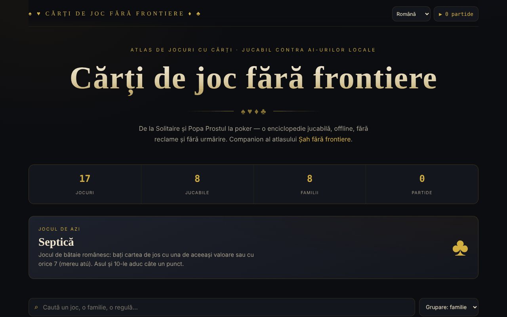

# Cărți de joc fără frontiere

[English](README.md) · **Română** · [Français](README.fr.md) · [Italiano](README.it.md) · [Español](README.es.md) · [Português](README.pt.md) · [Deutsch](README.de.md) · [Magyar](README.hu.md)

**Versiune:** 2.1.0 · **Ultima actualizare:** 2026-10-27

**Stare:** stabilă; recenzia din 2026-10-27 aplicată (vezi CHANGELOG.md); modul multiplayer local unificat este **planificat**, neimplementat · **Offline:** complet (fără cereri de rețea)

Limbile interfeței: **Română, English, Français, Italiano, Español, Português (PT), Deutsch, Magyar**

Atlas de jocuri cu cărți, cu opt jocuri jucabile, într-un singur fișier HTML.

**Nou în 2.0.0 – Atelier de reguli:** definești un joc într-un fișier JSON (levate cu atu și puncte, sau scăpat de cărți cu efecte), îl validezi, îl joci contra AI-ului local, îl salvezi sau îl descarci. Cinci exemple didactice incluse (nu sunt reguli oficiale).
Fișierul e limitat la 100 KB și validat strict; totul rulează local, fără server și fără p2p pentru jocurile personalizate.

**Live:** https://chiuta.github.io/Carti-de-joc-fara-frontiere/

## Ce este

Un atlas interactiv de jocuri cu cărți, de la Solitaire și Popa Prostul până la poker, descris în aplicație drept „enciclopedie jucabilă, offline, fără reclame și fără urmărire”. Catalogul grupează jocurile pe familii; pentru fiecare joc există o fișă cu informații și reguli, iar o parte dintre ele pot fi jucate direct în pagină. Este companionul atlasului „Șah fără frontiere”.

## Funcții

- Catalog cu 17 jocuri, grupate în familii: Pentru copii & rapide, Jocuri românești, De aruncare, Cu levate, Combinații & remi, Familia pokerului, Cazinou & pariuri, Pacient (solitaire).
- Opt jocuri jucabile (conform notei din subsol): Solitaire (Klondike), Război, Popa Prostul, Macao, Crazy Eights (Opt nebun, 1 la 1 cu calculatorul), Septică, Blackjack și Texas Hold'em. Restul sunt documentate.
- Căutare în titluri, descrieri, etichete și reguli („Caută un joc, o familie, o regulă…”).
- Sortare: grupare pe familii, alfabetic A→Z, dificultate crescătoare, jucabile întâi.
- Filtre pe familii, plus filtrul „★ Doar jucabile”.
- Fișă de joc cu număr de jucători, epocă, dificultate; marcare ca favorit (★).
- Joc zilei și contor de statistici (jocuri, jucabile, familii, partide jucate).
- Accesibilitate la masă: nume de cărți în română și anunțarea mesajelor jocului pentru cititoare de ecran.
- Buton **▶ Joacă** în fișa fiecărui joc jucabil; **Închide** / ✕ / **Esc** pentru ieșire.

## Manual de utilizare

1. Deschide pagina; sus vezi statisticile și jocul zilei.
2. Caută în câmpul de căutare sau alege o familie din chip-uri; schimbă ordinea din lista de sortare.
3. Apasă pe un joc pentru a deschide fișa cu reguli. Apasă ★ din fișă pentru a-l marca favorit.
4. Dacă jocul este marcat „Jucabil”, apasă **▶ Joacă** și urmează indicațiile de pe masă.
5. Închide fișa sau masa de joc cu **Închide**, ✕ sau **Esc**.
6. Contorul „▶ N partide” din colțul de sus arată câte partide ai început.

## Avertisment

Jocurile (inclusiv Blackjack și Texas Hold'em, din familia „Cazinou & pariuri") sunt simulări educaționale cu jetoane virtuale; nu se mizează bani reali. Jocurile de noroc pe bani pot crea dependență și sunt destinate adulților. Adversarii din jocurile jucabile sunt programe locale (aplicația le numește „AI-uri locale"); aplicația afișează o notă în subsol.

## Confidențialitate și rețea

- **Stocare locală (localStorage):** două chei cu prefix `carti-de-joc.`, `carti-de-joc.fav` (jocurile favorite) și `carti-de-joc.played` (numărul de partide). Nu sunt trimise nicăieri.
- **Rețea:** nu există cereri `fetch`, scripturi, fonturi sau imagini externe. Pagina include doar linkuri care se deschid la clic: Șah fără frontiere (alexio.tf), Buy Me a Coffee. Pagina are o politică CSP restrictivă (`default-src 'self'`). Nu există telemetrie.

## Rulare locală / offline

Descarcă `index.html` și deschide-l în browser; nu are nevoie de internet (linkurile externe au nevoie).

## Licență

Licență MIT — vezi fișierul `LICENSE`. Antetul din `index.html` și textul din interfață indică aceeași licență (o mențiune anterioară „CC-BY-SA 4.0” din interfață a fost eliminată la audit, 2026-10-11, pentru a elimina contradicția).

## Mărci

Numele de jocuri sunt denumiri comerciale ale deținătorilor lor, folosite descriptiv; proiectul nu este afiliat cu aceștia.

## Audit

Audit: 2026-10-10 — verificat cu Playwright și axe-core (catalog, fișe și mesele celor șapte jocuri de atunci); verificat în cod: fără `fetch`, CSP `default-src 'self'`. Corectat: un checkbox decorativ focalizabil (axe serious); adăugat avertisment despre jocurile de noroc.

## Autor

Alexio — Alexandru-Ionuț Chiuță, Centrul StrING (după cum este menționat în aplicație). Contact: alexio@trom.tf

## Rezumat

Cărți de joc fără frontiere este un atlas într-un singur fișier cu 17 jocuri de cărți grupate pe familii, cu căutare, sortare, favorite și opt jocuri care se pot juca (Solitaire Klondike, Război, Popa Prostul, Macao, Crazy Eights, Septică, Blackjack, Texas Hold'em). Stochează în localStorage doar favoritele și un contor al jocurilor jucate și nu încarcă resurse externe. Interfața este în română. Licență MIT (vezi LICENSE).

## Funcții noi (v1.1.0)

- **Joc în doi pe rețea** (butonul „Joacă în doi, pe rețea” din fișa Crazy Eights): meci între doi oameni, aceeași împărțire la ambii (sămânță comună), mâna adversarului rămâne ascunsă, mutările în afara rândului sunt respinse. Conexiunea se face direct între cele două browsere (WebRTC), fără server al nostru: schimbi două texte (ofertă/răspuns), ca text sau cod QR, prin orice canal ales de tine. Implicit nu se contactează niciun server STUN; unul poate fi introdus manual în fereastra de conectare, doar dacă îl vrei. Dacă legătura se întrerupe, aplicația o arată și poate relua jocul din jurnalul mutărilor.
- **Căutare locală** în catalogul de jocuri (FFF.search): găsește și fără diacritice sau cu mici greșeli, în textul regulilor și al descrierilor; fără rețea.
- **Citire cu voce** a regulilor (buton „Ascultă”, FFF.tts), cu alegerea vocii.
- Kit comun (core, label, bundle, qr, p2p, tts, search): etichetă de versiune, copie .fff.json.
- Textele noi sunt în toate limbile aplicației (inclusiv hu/de unde există sistem i18n); traducerile automate sunt neverificate nativ.
- Teste: `tests/fff-r8.test.mjs` (rețea blocată, două contexte conectate prin dialogul real, axe 0 violări la 1280 și 360 px).

## Istoric / Changelog

- 1.2.9 — 2026-10-23: Corectat: în Crazy Eights în rețea, o mutare cu culoare invalidă (ex. 1,5) după un 8 este respinsă (era acceptată); hash CSP recalculat.
- 1.2.8 — 2026-10-23: Cheile de stocare au acum prefixul aplicației (`carti-de-joc.lang`, `carti-de-joc.fav`, `carti-de-joc.played`); datele existente (limba, favoritele, rundele jucate) se migrează automat la pornire, iar copiile vechi `.fff.json` se pot importa în continuare. fff-kit 1.2.0: stocare fără prefix remediată
- 1.2.6 — 2026-10-22: fff-kit 1.1.4: ținte tactile și text minim
- 1.2.5 — 2026-10-22: fff-kit 1.1.2: PBKDF2 600 000 iterații, protecție anti-clickjacking
- 1.2.4 — 2026-10-22: finisaje pentru mobil și accesibilitate: text de cel puțin 12 px și ținte tactile de cel puțin 24 px. focus de tastatură vizibil pe orice control.
- 1.2.3 — 2026-10-22: Fix de traducere: descrierea (și numele) din panoul de transparență urmează acum limba interfeței.
- 1.2.2 — 2026-10-22: **remediere**: titlul paginii și titlul principal urmează acum limba aleasă.
### 14 octombrie 2026 (v1.1.0)
- Nou: joc în doi pe rețea la Crazy Eights, căutare locală tolerantă la diacritice și greșeli, citirea regulilor cu voce, kit comun, teste.

### 12 octombrie 2026 (v1.0.0)
- 1.0.0 — 2026-10-12: versiunea și data ultimei actualizări sunt afișate în aplicație

### 11 octombrie 2026
- Cărțile de pe masă au acum nume accesibil în română („damă de inimă roșie”, „3 de caro”, „Carte întoarsă”) în loc de textul colțurilor repetat; cărțile pe care se poate da clic sunt butoane (rol `button`, Enter/Spațiu), celelalte imagini (rol `img`).
- Mesajele mesei de joc („Rândul tău.”, „Alege miza…”) sunt anunțate cititoarelor de ecran printr-o regiune live (verificat pe Solitaire, Macao, Blackjack, Septică).
- Joc nou jucabil: **Crazy Eights (Opt nebun)**, 1 la 1 cu calculatorul (7 cărți, 8 = jolly cu alegerea culorii, tragere până găsești carte validă); testat cu 40 de partide automate (52 de cărți conservate, fiecare partidă s-a încheiat). Acum 8 din 17 jocuri sunt jucabile.
- CSP: `script-src` pe hash SHA-256 (două scripturi), fără `'unsafe-inline'`.
- Blackjack: adăugate **split** (o singură dată, cărți de aceeași valoare; asul divizat primește o singură carte), **asigurare** 2:1 când dealerul arată As și dublare pe orice mână; verificat cu mâini fixe (plăți, bancă, egalități).
- Pe mobil pastila de donații este implicit un buton ♥ mic (se extinde la atingere) și pagina are margine jos, ca să nu acopere conținutul; controalele ei sunt acum accesibile de la tastatură.
- Conținutul este încadrat în `<main>`/`<header>`; ferestrele (fișă, masă) au rol de dialog; ordinea titlurilor corectată (axe: 0 încălcări).
